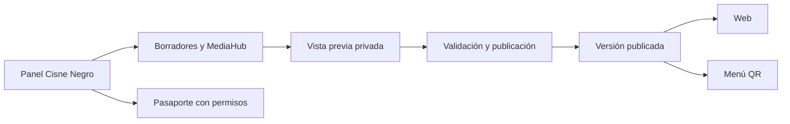

# Plan de CMS + MediaHub para Cisne Negro

Fecha: 8 de octubre de 2026. Documento de planificación original. El usuario autorizó posteriormente la implementación y publicación en `/cms/`; consultar el estado operativo y las instrucciones en [07-guia-cms.md](07-guia-cms.md). Las etapas y estimaciones siguientes se conservan como antecedente del plan.

## 1. Resultado esperado

Un panel de Cisne Negro con editor visual, catálogo de cerveza y cocina, biblioteca de fotos y videos, eventos y acceso al Pasaporte. Los dueños podrán actualizar la web y el menú sin editar archivos: **editar → guardar borrador → ver vista previa → publicar → consultar historial**.

Ejemplo: elegir una cerveza, cambiar su precio, seleccionar su fotografía desde MediaHub y revisar cómo aparecerá en celular. Al publicar, la portada y el menú QR mostrarán la misma información. Si hay un error, se podrá volver a la versión anterior del contenido sin modificar visitas ni canjes del Pasaporte.

## 2. Base revisada y referencia de Vivemar

La referencia se utiliza para la experiencia y los patrones técnicos; la identidad, contenidos y datos serán exclusivamente de Cisne Negro.

| Capacidad observada en Vivemar | Aplicación a Cisne Negro |
|---|---|
| Editor visual con página en pantalla, selección de textos e imágenes y vistas escritorio/móvil | Edición de bloques definidos de la landing y vista previa del menú |
| Biblioteca con subida múltiple, miniaturas, categorías, búsqueda, origen, dimensiones y peso | MediaHub de cervezas, cocina, barra, elaboración, comunidad, eventos y marca |
| Selector de biblioteca dentro del editor | Una misma biblioteca para portada, productos, historia, galería y eventos |
| Formularios de textos y ajustes globales | Alternativa accesible al editor visual; contacto, horarios, enlaces y datos del negocio |
| Importación de imágenes y detección de duplicados | Importar el archivo propio de Cisne Negro con metadatos y duplicados comprobados por el servidor |

El código de Vivemar publica mediante modificaciones de HTML y archivos; su cola de cambios vive en el navegador. Los borradores persistentes, las versiones, los roles, el seguimiento de usos y el video nativo son trabajo adicional para Cisne Negro. El plan social de Vivemar contiene ideas que no deben confundirse con capacidades ya implementadas.

**Inventario de Cisne Negro al revisar el proyecto:**

- 49 productos: seis cervezas de barril, 18 latas, 20 platillos y cinco bebidas sin alcohol; el Vuelo del Cisne tiene configuración independiente.
- 47 imágenes y dos videos en los recursos del sitio.
- 431 archivos multimedia en `contenido/`, incluidos 55 MP4. Estos conteos no están deduplicados ni equivalen a material aprobado para publicar.
- Panel de Pasaporte operativo en código: socios, visitas, canjes, NPS, estadísticas y ranking.
- Menú basado en JSON; varias secciones de la landing, datos de contacto y metadatos todavía están escritos directamente en HTML.

## 3. Estructura del panel

| Módulo | Qué podrá hacer el equipo |
|---|---|
| **Inicio** | Ver pendientes de publicación, últimos cambios, próximos eventos, almacenamiento y accesos a la operación |
| **Editor visual** | Seleccionar bloques de la página; editar textos, imágenes y botones; previsualizar escritorio y móvil; guardar borradores |
| **Cervezas y barriles** | Administrar nombre, estilo, ABV, perfil, notas, historia, foto, presentaciones y precios; ordenar y marcar disponibilidad |
| **Menú y maridajes** | Crear, editar, ocultar y ordenar categorías y productos; gestionar latas, cocina, bebidas y relaciones de maridaje; configurar el Vuelo |
| **MediaHub** | Subir, organizar, buscar, previsualizar y reutilizar imágenes y videos; consultar dónde se utilizan |
| **Eventos y galería** | Crear eventos con fecha, portada, descripción y enlace; ordenar galerías; retirar eventos pasados de la portada sin perder su registro |
| **Datos del negocio** | Actualizar horarios, dirección, teléfono, WhatsApp, redes, ubicación y metadatos de las páginas existentes |
| **Pasaporte** | Acceder a las funciones actuales de socios, código del día, visitas, canjes, NPS, estadísticas y ranking, según permisos |
| **Publicaciones** | Revisar cambios pendientes, autor, fecha, versión publicada y restauración de contenido |
| **Usuarios y ajustes** | Administrar cuentas, permisos, sesiones, almacenamiento y estado de respaldos |

Diseño con el sistema **Neón y tinta**: negro cálido, hueso, ámbar y naranja; tipografías y mascota existentes. Navegación lateral en escritorio y menú compacto en celular. El personal podrá completar tareas frecuentes desde el teléfono.

## 4. MediaHub de cerveza y experiencia

La primera versión completa incluirá:

1. **Biblioteca única:** carga múltiple, arrastrar y soltar, progreso por archivo, reintento de fallos y búsqueda paginada con miniaturas.
2. **Organización:** categorías Cervezas, Cocina, Barra y lugar, Elaboración, Comunidad, Eventos y Marca; colecciones para campañas, temporadas o eventos. Cada archivo admite etiquetas propias.
3. **Ficha editable:** título, texto alternativo, descripción/caption, categoría, etiquetas, origen, fecha conocida y enlace a la publicación original. Los campos desconocidos quedan vacíos.
4. **Preparación de imágenes:** conservar original, crear versiones optimizadas, miniaturas y punto focal para recortes de portada o tarjeta. Validar JPG, PNG y WebP; comprobar soporte de HEIC/HEIF antes de habilitar su conversión.
5. **Video:** incorporar los MP4 disponibles, reproducir vista previa, seleccionar poster y elegir versiones de escritorio/móvil del hero. Los videos nuevos tendrán validación y procesamiento en segundo plano; no habrá una línea de tiempo de edición audiovisual dentro del CMS.
6. **Reutilización segura:** seleccionar desde cada editor por identificador; mostrar usos y distinguir «sustituir solo aquí» de un cambio global deliberado. Archivar un archivo no romperá las publicaciones que ya lo usan.
7. **Duplicados y papelera:** detectar duplicados exactos por contenido, conservar referencias y permitir recuperación; impedir eliminar físicamente recursos usados por contenido publicado o versiones retenidas.
8. **Importación inicial:** revisar los recursos del sitio y el archivo local de Cisne Negro, deduplicarlos y conservar la procedencia. El material importado queda pendiente de revisión hasta que el equipo apruebe su uso.

La importación inicial no necesita conectar cuentas sociales. Sincronizar Instagram, Facebook o TikTok, clasificar con IA y publicar directamente en redes serán ampliaciones con permisos, costos y alcance propios.

Para las cargas se definirán tipos, peso por archivo, resolución, duración y cuota total; se comprobará el contenido real de cada archivo y se separarán originales privados de derivados publicados. Referencia técnica: [OWASP, File Upload](https://cheatsheetseries.owasp.org/cheatsheets/File_Upload_Cheat_Sheet.html).

## 5. Edición, permisos y publicación

- **Propietario:** usuarios, configuración, publicación y reversión de contenido; acceso a la operación del club.
- **Editor:** catálogo, web, eventos y MediaHub; borradores y vista previa. La facultad de publicar contenido público será un permiso explícito, desactivado inicialmente. Sin acceso a socios, exportaciones, NPS privado ni canjes.
- Se parte de las **tres cuentas y dos roles** de la propuesta actual. Si el personal de barra necesita cuentas dedicadas, se definirá un tercer rol restringido y el número de cuentas como ampliación, antes de habilitarlo.

Los permisos se validarán en el servidor, incluidas las rutas administrativas existentes del Pasaporte. Ocultar una pestaña no será un control suficiente. Se usarán sesiones individuales de personal independientes del ingreso de socios, cierre de sesiones, protección de operaciones y registro de autoría. Referencia: [OWASP, Authorization](https://cheatsheetseries.owasp.org/cheatsheets/Authorization_Cheat_Sheet.html).

Publicar mostrará un resumen de cambios y validará precios, enlaces, referencias y archivos. Una edición simultánea deberá avisar del conflicto en lugar de sobrescribir el trabajo de otra persona. El borrador seguirá disponible después de cerrar y volver a abrir el panel.

La edición visual se limitará a los bloques aprobados. Campos de menú, botones y enlaces tendrán controles propios; los textos no aceptarán scripts ni HTML arbitrario.

## 6. Integración técnica propuesta

Mantener la web actual y aprovechar el entorno Python, SQLite y Nginx del proyecto. Adaptar la interfaz de Vivemar a módulos de Cisne Negro; el backend del CMS se implementará como servicio modular de contenido y publicación. La selección del framework y del procesador multimedia se cerrará en la primera etapa tras revisar el servidor y sus dependencias.

Decisiones de implementación:

- **Datos estructurados:** productos, categorías, cervezas, precios por presentación, maridajes, bloques, eventos, medios, usuarios y revisiones. Introducir identificadores estables donde faltan y estados explícitos de disponibilidad y publicación.
- **Referencias estables:** conservar los identificadores actuales de cervezas y platillos; sustituir las deducciones de categoría basadas en nombres de imagen por campos del catálogo. Cambiar una foto desde MediaHub no debe alterar el nombre o tipo del producto.
- **Una fuente editorial:** importar `menu.json`; pasar a generar desde el CMS su representación pública compatible. El equipo deja de mantener en paralelo un JSON manual. Se conserva la dirección del menú QR.
- **Publicación consistente:** preparar una versión completa de contenido, HTML y metadatos; activarla únicamente tras validarla. Cada página y su menú deben leer la versión correspondiente, evitando mezclar precios de dos revisiones. Un fallo conserva la última versión válida.
- **Vista previa privada:** no exponer borradores por una URL pública ni permitir que se indexen. Las fotos nuevas aún no publicadas se sirven bajo acceso del equipo.
- **Datos duraderos:** contenido, originales, derivados y versiones fuera del árbol que reemplaza el despliegue. El `rsync --delete` actual debe adaptarse para no borrar ni reponer datos administrados por el cliente.
- **Pasaporte independiente:** conservar la base del club y su historial. El CMS tendrá almacenamiento editorial separado. Revertir la web no puede revertir socios, visitas, NPS ni canjes posteriores.
- **Procesamiento aislado:** las conversiones de fotos y videos no deben bloquear registro de visitas ni canjes. Ajustar cuotas, límites de subida y permisos de escritura del servicio antes del piloto.
- **Respaldo recuperable:** ampliar el respaldo actual del club para cubrir contenido, medios y versiones. Mantener al menos los 14 días ofrecidos para el CMS y no reducir los 30 días existentes del club; probar una restauración completa con referencias correctas.

La importación será repetible y tendrá una comparación previa de productos, precios, identificadores, maridajes y enlaces. Se conservará una primera revisión equivalente al sitio actual como punto de recuperación antes de activar la nueva fuente editorial.

## 7. Etapas y entregas

Estimación inicial: **seis semanas de trabajo**, con una persona responsable del desarrollo, revisión semanal y un responsable del cliente para validar contenido. Es una estimación para este alcance ampliado; se afina al terminar la semana 1 y depende de accesos, capacidad del servidor y tiempos de revisión.

| Etapa | Trabajo principal | Entrega verificable |
|---|---|---|
| **Semana 1 · Diseño y base** | Mapa de pantallas, modelo editorial, permisos, revisión de infraestructura y esquema de migración | Prototipo navegable; acceso individual en entorno de prueba; catálogo de campos y permisos; importación inicial validada |
| **Semana 2 · MediaHub** | Cargas, miniaturas, ficha editable, categorías, etiquetas, duplicados, selector e importación del archivo | Subir, encontrar y seleccionar una imagen desde un editor; comprobar una carga fallida y su reintento |
| **Semana 3 · Menú y cervezas** | Productos, categorías, presentaciones, disponibilidad, Vuelo y maridajes; salida compatible con landing y QR | Editar un producto y comprobar el mismo precio, foto y disponibilidad en ambas vistas previas |
| **Semana 4 · Editor visual y contenido** | Portada, historia, botones, galería, eventos, contacto, horarios y metadatos | Recorrido completo de edición visual y por formulario; borrador persistente y vista previa móvil |
| **Semana 5 · Publicación y operación** | Versiones, conflictos, reversión, video/poster, permisos del club, despliegue y respaldos | Publicar y revertir una versión de contenido en prueba; confirmar que el Pasaporte conserva sus movimientos |
| **Semana 6 · Piloto y entrega** | Pruebas, ajustes de uso en barra, capacitación y preparación de lanzamiento | Recorrido aceptado por los dueños, guía, respaldo restaurado y paquete de publicación listo |

La primera revisión útil será el prototipo de la semana 1; la primera entrega operativa de biblioteca llegará en la semana 2. Las conversiones se investigan desde la semana 1, aunque el flujo final de video se cierre en la 5. La integración de permisos comienza en la base, antes de exponer herramientas administrativas al editor.

El lanzamiento se realizará después de validar el piloto y contar con autorización para publicar el CMS. Este documento no programa ni ejecuta cambios sobre la web publicada.

## 8. Pruebas de aceptación

1. Cambiar precio, imagen y disponibilidad de una cerveza; comprobar consistencia en web y menú. Un producto agotado no puede elegirse para el Vuelo ni recomendarse como disponible.
2. Subir una imagen desde celular, encontrarla por etiqueta, asociarla a un platillo y ajustar su punto focal. Subir el mismo archivo otra vez no duplica el almacenamiento sin necesidad.
3. Configurar hero con video y poster: vista móvil, pausa, respaldo ante error y preferencias de movimiento reducido conservadas.
4. Guardar un borrador, cerrar sesión y recuperarlo. Un visitante no puede leerlo y otro editor no puede sobrescribirlo silenciosamente.
5. Publicar cambios y restaurar la versión anterior. Simular una publicación fallida y confirmar que el sitio conserva una versión completa y utilizable.
6. Intentar acceder como editor a socios, CSV, NPS y canjes mediante la API: el servidor lo impide. La baja de una cuenta revoca su sesión.
7. Completar registro, visita, encuesta y canje del Pasaporte antes y después de la migración en un entorno de prueba; sin pérdida de datos ni doble canje.
8. Intentar borrar una foto utilizada; el panel explica dónde se usa e impide dejar referencias rotas. Validar archivos con formato falso, tamaño excesivo y contenido no admitido.
9. Ejecutar un despliegue de prueba y restaurar un respaldo: siguen presentes fotos, videos, borradores, versiones y contenido publicado; el respaldo editorial no sustituye la base viva del club.
10. Revisar tareas críticas en celular de 360 px, tableta y escritorio, con teclado, etiquetas y foco visibles. La biblioteca carga por páginas y miniaturas, no todos los originales a la vez.

## 9. Alcance comercial y siguientes pasos

La propuesta vigente asigna **$8,000 MXN al CMS dentro de los $32,000 MXN de implementación**, con plazo global estimado de cuatro semanas. Incluye edición estructurada, imágenes, selección del hero ya optimizado, tres cuentas y dos roles.

Este plan agrega editor visual, MediaHub completo, importación masiva del archivo, video nativo, historial y reversión. **No se da por incluido íntegramente en esos $8,000 MXN ni se cambia la cotización publicada.** El esfuerzo y la inversión del alcance ampliado se estimarán por módulo al cerrar el diseño. Se conserva la separación entre implementación técnica, administración mensual y la consultoría Beervibes de 90 días.

Quedan para una etapa posterior: sincronización automática con redes, generación o clasificación con IA, edición/montaje de video, publicación social, punto de venta, pedidos, cobros, reservaciones y nuevas mecánicas de puntos o retos del Pasaporte.

Primer paso propuesto: diseñar las pantallas de Inicio, Editor visual, MediaHub y Menú con datos de Cisne Negro; cerrar la matriz de campos y permisos, y revisar juntos el recorrido de **elegir foto → editar cerveza → previsualizar → publicar** antes de construir todos los módulos.

## 10. Referencias revisadas

- Vivemar: `../vivemar/public/admin/editor.php`, `mediahub.php`, `api.php`, `lib.php`, `ajustes.php`, `estado.php` y `../vivemar/docs/plan-media-hub-social.md`. Referencia de funcionamiento; sin trasladar datos ni medios de ese cliente.
- Cisne Negro: `sitio/data/menu.json`, `sitio/assets/js/landing.js`, `menu.js`, `admin.js`, `sitio/index.html`, `backend/club_server.py`, `deploy/publicar.sh`, `deploy/cisnenegro-club.service`, `deploy/backup-club.sh`, `sitio/DESIGN.md` y `propuesta-economica/propuesta-economica.md`.
