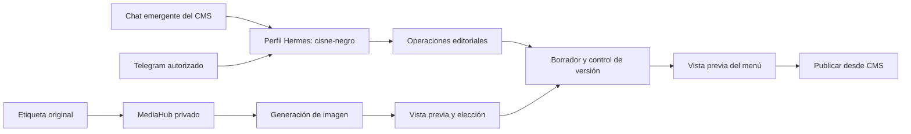

# Agente Cisne · CMS y Hermes / Telegram

Asistente de Cisne Negro: conocimiento del negocio, diseño y desarrollo, CRUD editorial y flujo de imágenes del menú a partir de etiquetas. Se abre con el **botón flotante Agente Cisne** desde cualquier sección autenticada del CMS. El enlace **`/cms/#agente`** también abre la ventana. El chat se conecta al perfil Hermes **`cisne-negro`**.

## Estado de esta entrega

- **Perfil del usuario identificado:** `cisnenegro` en `169.58.107.205`. Es distinto del perfil `cisne-negro` actualmente conectado al CMS. Su conexión está preparada en código, pendiente de acceso SSH, autenticación de modelo y ensayo en ese servidor. Ver [pasos y distinción de perfiles](hermes/CONEXION-PERFIL-REMOTO.md).
- **Desplegado el 21 de octubre de 2026:** popup y chat Hermes disponibles en [https://cisne.softvibes.art/cms/](https://cisne.softvibes.art/cms/). Cerrar la ventana conserva conversación, mensaje pendiente y etiqueta hasta salir de la sesión o recargar la página.
- Perfil `cisne-negro` configurado en producción con `gpt-6-astra`. Una consulta real usó `read_content`; el borrador 5 y la publicación 8 permanecieron intactos. No se copiaron memorias, bots ni datos de otros clientes.
- El chat web utiliza el modelo, la autenticación y la identidad del perfil Hermes. Las imágenes requieren `OPENAI_API_KEY` en el servidor; la autenticación de Hermes no sustituye esa clave para generar imágenes.
- Telegram requiere un bot dedicado, sus operadores permitidos y una cuenta CMS editorial. El gateway todavía no está iniciado.
- La generación de imágenes está desactivada hasta configurar su API; sus pruebas usan un proveedor simulado. El código del agente está en la rama `feat/agente-cisne-cms-hermes`; `main` no incorpora todavía esta integración.
- `cisnenegro.mx` presenta una incidencia DNS (`SERVFAIL`); el temporal tiene HTTPS válido y sirve la misma aplicación. El servidor responde con el dominio canónico al conectar directamente con SNI. Hace falta reconciliar dominio y zona con Hostinger; no se cambiaron DNS en este despliegue. Ver [registro operativo](../hosting-independiente/docs/agente-cisne-despliegue-2026-10-21.md).

## Qué puede hacer

| Desde el agente | Resultado |
|---|---|
| Consultar la carta y el negocio | Lee contenido y versión vigentes del CMS |
| Crear, editar o eliminar cervezas, alimentos, bebidas, eventos y galería | Cambios acotados por ID en el borrador |
| Cambiar textos de portada, contacto y horarios | Actualización parcial de los campos admitidos |
| Ocultar un producto temporalmente | Conserva su ID e historial |
| Recibir una etiqueta | Guarda el original en MediaHub y permite leer la referencia visual |
| Generar una imagen para una cerveza | Trabajo privado, vista previa y selección explícita del resultado |
| Proponer contenido y diseño | Usa la identidad y las fuentes del proyecto |
| Desarrollar funciones desde Hermes | Trabaja en el repositorio con herramientas de desarrollo y pruebas |

El chat del CMS no ejecuta comandos de servidor ni modifica código. La publicación sigue en el control existente del CMS, con rol propietario. El cliente Hermes ofrece publicación explícita separada; una cuenta editorial no puede usarla. El Content Hub y la publicación en redes no forman parte de este CRUD.



La implementación usa un agente con herramientas, no una cadena de agentes independientes para cada paso. El [flujo de etiqueta](flujo-etiqueta.json) documenta contratos, límites y errores.

## Probar en local

Desde `hosting-independiente/`, ejecutar `./iniciar-local.sh --hermes` y abrir `http://127.0.0.1:8088/cms/`. Los accesos locales quedan en la carpeta de datos indicada al iniciar. Pulsa **Agente Cisne** abajo a la derecha. La pestaña **Conversación** usa Hermes; **Etiqueta a imagen** reúne la referencia, la cerveza y los resultados. Escape o × cierran la ventana; el foco vuelve al botón.

En local, el conector usa por defecto `~/.hermes/hermes-agent/venv/bin/python3` y `~/.hermes/profiles/cisne-negro/`. Las variables `CISNE_HERMES_ROOT` y `CISNE_HERMES_PROFILE_DIR` permiten configurar rutas propias; no se aceptan desde el navegador. El perfil debe llamarse `cisne-negro`. Si no está disponible, el CMS conserva su funcionamiento y muestra conexión pendiente.

En producción, el CMS en Docker se conecta mediante `CISNE_HERMES_SOCKET=/run/cisne-hermes/bridge.sock` al servicio privado del host `cisne-hermes`. Solo el directorio del socket se monta en el contenedor, en modo de solo lectura; el perfil y su autenticación permanecen en el host. El [override Compose](../hosting-independiente/deploy/compose.hermes.yaml) está instalado como `deploy/compose.override.yaml` para que lo utilicen también los comandos operativos existentes.

Configurar fuera del repositorio, en el entorno que arranca el servidor:

```dotenv
CISNE_AGENT_PROVIDER=hermes
OPENAI_API_KEY=
CISNE_AGENT_MODEL=gpt-6-astra
CISNE_IMAGE_MODEL=gpt-image-2.5-sunburst
```

La plantilla `.env.example` no se carga automáticamente al iniciar con Python. En Docker Compose se usa el archivo privado de variables definido por el despliegue. Reiniciar la aplicación después de cambiar las variables. Nunca poner claves en JavaScript, mensajes, capturas o Git.

El conector ejecuta una ronda del modelo mediante `AIAgent` de Hermes y devuelve las llamadas al CMS. Solo el CMS ejecuta las tres herramientas editoriales permitidas con la cuenta que inició sesión. No inicia el gateway, no da acceso a terminal, no carga memorias ni conversaciones de Telegram y no comparte sesiones entre editores. La identidad `SOUL.md` y el modelo pertenecen al perfil; las reglas del canal CMS restringen sus capacidades. El puente usa APIs internas de Hermes: debe verificarse de nuevo al actualizarlo.

Las imágenes utilizan la API de edición de imágenes. Las solicitudes llevan la etiqueta y una referencia editorial de Colchita, cuando está disponible. No se envían cookies, cuentas del CMS ni datos de socios al modelo. La alternativa directa al chat es `CISNE_AGENT_PROVIDER=openai`, con `OPENAI_API_KEY` y `CISNE_AGENT_MODEL`.

## Flujo de una cerveza nueva

1. Adjuntar una foto legible de la etiqueta o elegirla en MediaHub.
2. Pedir al agente que cree la cerveza. Resolver los datos que falten: nombre, estilo, ABV, perfil, presentación y precio. No se rellenan con valores inventados.
3. Conservar el original como `etiqueta`; la generación usa el ID de la referencia y la versión del borrador.
4. Solicitar la imagen. Se registra un trabajo y se muestra su avance; se puede recuperar al recargar el CMS.
5. Revisar nombre, identidad, estilo, porcentaje y encuadre. El resultado es una ilustración editorial, no una etiqueta oficial nueva.
6. Elegir **Usar imagen en el borrador**. Solo cambia `img` de la cerveza seleccionada.
7. Revisar la vista previa. El propietario publica cuando corresponda, después de revisar todos los cambios pendientes.

En Telegram, Hermes descarga el resultado de forma autenticada en su directorio privado y puede mostrar el adjunto al operador antes de aplicarlo. Ver [perfil e instalación](hermes/README.md).

## Permisos, versiones y límites

Las rutas del agente reutilizan sesión, CSRF, origen y roles del CMS. No existe un acceso público del agente ni un token administrativo incrustado. Cada escritura valida el documento y compara la versión; un conflicto devuelve 409 y exige releer. La generación no asigna imágenes ni publica automáticamente.

Límites iniciales: 20 consultas por cuenta en diez minutos; tres rondas del modelo y tres cambios por consulta; dos procesos Hermes simultáneos y 65 segundos por ronda; seis trabajos de imagen por cuenta por hora y dos simultáneos. El chat conserva un historial acotado en memoria del navegador, que se borra al cerrar sesión. Los trabajos y su procedencia persisten en la base del CMS; las imágenes, en MediaHub.

Una petición de imagen repetida con la misma cerveza, etiqueta, versión y modelo reutiliza el trabajo existente. Los trabajos interrumpidos se muestran como fallidos después de diez minutos; no se reenvían automáticamente al proveedor. El reintento es explícito y puede tener coste del proveedor. Se conserva el intento anterior.

## API para Hermes y otros clientes privados

| Ruta | Función |
|---|---|
| `GET /cms/api/agent/config` | Estado de configuración, sin claves |
| `GET /cms/api/agent/content` | Documento, versión y campos permitidos |
| `POST /cms/api/agent/content` | `{version, operation}`: una operación CRUD |
| `POST /cms/api/agent/chat` | Mensaje, historial acotado, versión y etiqueta opcional |
| `POST /cms/api/agent/images` | `{collection, id, reference_media_id, version}` |
| `GET /cms/api/agent/images` | Últimos trabajos visibles para la cuenta |
| `GET /cms/api/agent/images/{id}` | Estado y resultado de un trabajo |

Publicación, vista previa y subidas utilizan las rutas existentes del CMS. El cliente Hermes ofrece comandos acotados y sesiones privadas; no es un proxy HTTP arbitrario. Consulta [su skill](hermes/skills/cisne-cms/SKILL.md).

## Fuentes y mantenimiento

- [Instrucciones del agente](instrucciones.md) y [conocimiento verificable](conocimiento/README.md).
- [Resumen incluido en la imagen del servidor](../hosting-independiente/backend/agent_knowledge.md): actualizar junto con el conocimiento si cambia la marca o el alcance.
- [Verificación de esta entrega](VERIFICACION.md).
- Documentación de implementación consultada: [OpenAI function calling](https://developers.openai.com/api/docs/guides/function-calling), [edición/generación de imágenes](https://developers.openai.com/api/docs/guides/image-generation), [perfiles Hermes](https://hermes-agent.nousresearch.com/docs/user-guide/profiles) y [Telegram](https://hermes-agent.nousresearch.com/docs/user-guide/messaging/telegram).
